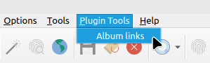
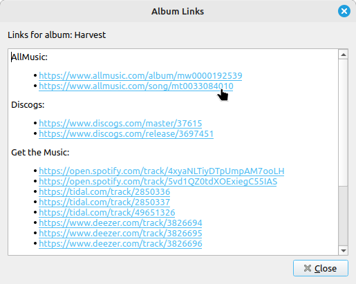
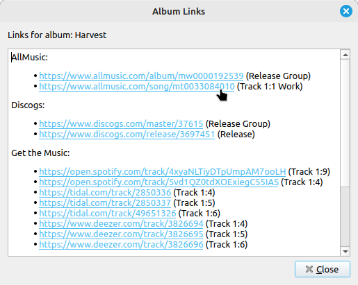
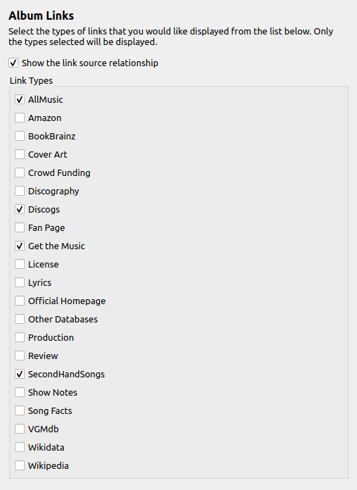

Album Links
===========

Overview
---------

This plugin provides quick links to an album's related web pages from the :menuselection:`Plugin Tools` menu. The types of links to be displayed are selected in the options settings page for the plugin.

What it Does
----------------

This plugin reads the metadata provided to Picard for the selected album, extracts the list of URL relationships, and displays a dialog window with clickable links to each of the URLs. The dialog is displayed by selecting :menuselection:`Plugin Tools --> Album links` from the main menu.

|

The dialog window displays the links grouped by the link type. The link types to display are selected in the option settings page for the plugin.

|

Clicking on a link will open it in the system default browser.

The links can also be displayed with information identifying the source of the link relationship. This is based on a setting in the option settings page for the plugin.

|

When the source information is displayed, it follows one of four standard formats:

1. "**Release**" indicates that it comes from a release relationship.

2. "**Release Group**" indicates that it comes from a release group relationship.

3. "**Track x:y**" indicates that it comes from a recording relationship associated with one of the tracks. In this case "x" is the medium number (such as the disc number), and "y" is the number of the track on that medium.

4. "**Track x:y Work**" indicates that it comes from a work relationship associated with the track's recording relationship. Similar to the previous format, "x" is the medium number, and "y" is the number of the track on that medium.

Option Settings
----------------

The plugin adds a settings page under the "Plugins" section under "Options..." from Picard's main menu. This allows you to control how the plugin operates with respect to displaying the links.

|

Show the link source relationship
++++++++++++++++++++++++++++++++++

This option determines whether or not the source relationship information for the link is displayed in the Album Links dialog.

Link Types
+++++++++++

This provides a list of the supported link types, and allows enabling the display for each type individually. Links will only be displayed in the Album Links dialog if they belong to one of the link types that are enabled (checked) in this list. Unchecked types will be ignored and will not be displayed in the Album Links dialog.

Examples
---------

There are no examples.

Source Code
----------------

The source code for this plugin is available on `GitHub <https://github.com/rdswift/picard-plugin-album-links>`_.
