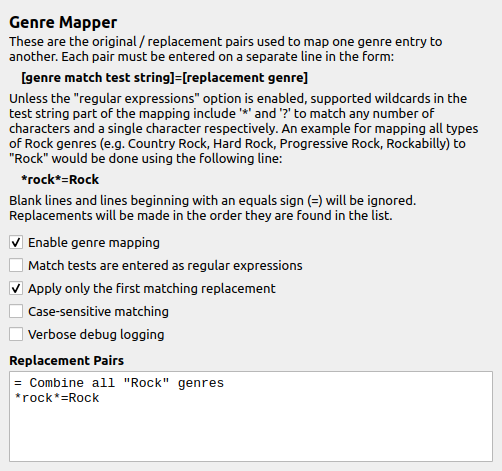

Genre Mapper
==============

Overview
---------

This plugin provides the ability to standardize genres in the "genre" tag by matching the genres as found to a standard genre as defined in the genre replacement mapping configuration option. Once installed a settings page will be added to Picard's options, which is where the plugin is configured.

What it Does
----------------

This plugin reads the track metadata provided to Picard, extracts the list of associated genres, and maps the existing genres to new values based on the configured replacement pairs.

.. note::

   The plugin does not add any new genres to the "genre" tag. It only modifies existing genres based on the configured replacement pairs.

   All genres will be output in title case (e.g., "Rock" instead of "rock") regardless of the case used in the replacement pairs.

Option Settings
----------------

The plugin adds a settings page under the "Plugins" section under "Options..." from Picard's main menu. This allows you to control how the plugin operates with respect to remapping the genres.

|

Enable genre mapping
+++++++++++++++++++++

This setting allows you to enable or disable the genre mapping functionality. If disabled, the plugin will not modify any genres.

Match tests are entered as regular expressions
+++++++++++++++++++++++++++++++++++++++++++++++

This setting allows you to specify whether the match test strings in the replacement pairs are treated as regular expressions or as simple wildcard patterns.

If enabled, the match test string portion of **every** pair must be a valid regular expression. Invalid regular expressions will be ignored and logged as errors. Otherwise, the match test strings can use the '*' and '?' wildcards to match any number of characters and a single character respectively.

If enabled, the replacement portion of the pair can include backreferences to capture groups specified in the match test string. Otherwise, the replacement portion of the pair is treated as a literal string and will not be interpreted as a wildcard pattern.

.. seealso::

   For more information about regular expressions, please refer to the `Python Regular Expressions <https://docs.python.org/3/library/re.html>`_ documentation, `Wikipedia <https://en.wikipedia.org/wiki/Regular_expression>`_, and the `Regular Expressions Tutorial <https://www.geeksforgeeks.org/dsa/write-regular-expressions/>`_.

Apply only the first matching replacement
++++++++++++++++++++++++++++++++++++++++++

This setting allows you to choose whether or not to apply the first matching pair only, or continue processing the remaining pairs with the updated genre. By default, all of the pairs are processed.

Case-sensitive matching
++++++++++++++++++++++++

This setting determines whether or not the match tests are performed as case-sensitive. This applies to both regular expressions and wildcard patterns. By default, the match tests are case-insensitive.

Verbose debug logging
++++++++++++++++++++++

This setting allows you to enable or disable verbose debug logging. If enabled, the plugin will log additional information about the processing of the genre mapping, which can be useful for troubleshooting. Errors are always logged regardless of this setting.

Replacement Pairs
++++++++++++++++++

This setting allows you to specify the list of original/replacement pairs used to modify the genres provided in the "genre" tag. Each pair must be entered on a separate line in the form:

.. code-block:: none

   [genre match test string]=[replacement genre]

If the "Match tests are entered as regular expressions" option is disabled, supported wildcards in the test string part of the mapping include '*' and '?' to match any number of characters and a single character respectively. The replacement portion of the pair is treated as a literal string and will not be interpreted as a wildcard pattern.

If the "Match tests are entered as regular expressions" option is enabled, then the match test string portion of **every** pair must be entered as a regular expression. The replacement portion of the pair can include backreferences to capture groups specified in the match test string.

Blank lines and lines beginning with an equals sign (=) will be ignored. This allows you to add comments and blank lines to the replacement pairs configuration for readability.

Leading and trailing spaces will be removed from all match test strings and replacement strings before processing.

If the replacement part of the pair is blank, any matching genres will be removed.

Replacements will be made in the order they are found in the list.

Examples
---------

**Example 1**

Suppose that you want to combine all the different types of rock genres (e.g. Country Rock, Hard Rock, Progressive Rock, Punk Rock, Rock 'n' Roll) into a single "Rock" entry. This could be done using the following matching pairs configuration:

.. code-block:: none

   = Combine all "Rock" genres
   *rock*=Rock

**Example 2**

Similar to Example 1, except that you want to keep "Punk Rock" separate from "Rock". This could be done by enabling the "Apply only the first matching replacement" option and using the following matching pairs configuration:

.. code-block:: none

   = Keep "Punk Rock"
   punk rock=Punk Rock

   = Combine all "Rock" genres
   *rock*=Rock

This would cause a genre of "Punk Rock" to match the first test, keep the genre as "Punk Rock" and stop processing that genre entry. If the "Apply only the first matching replacement" option was not enabled, processing would continue and the next match would change the genre to "Rock".

**Example 3**

Similar to Example 2, except that you want to keep processing rather than stop on the first match. This could be done by disabling the "Apply only the first matching replacement" option and using the following matching pairs configuration:

.. code-block:: none

   = Keep "Punk Rock" as temporary "Temp1" tag so
   = that it doesn't match any following lines
   punk rock=Temp1

   = Combine all "Rock" genres
   *rock*=Rock

   ===========================================
   = Additional processing pairs as required =
   ===========================================

   = Change the "Temp1" tag back to "Punk Rock"
   temp1=Punk Rock

This would cause a genre of "Punk Rock" to match the first test, changing the genre to "Temp1" (not matched in any of the following processing pairs) and continue processing. The final processing pair matches the "Temp1" genre set earlier and changes the genre back to "Punk Rock".

**Example 4**

Perhaps you want to remove all "Pop" genres, including genres where "Pop" is part of a hyphenated word (e.g. K-Pop) but not where "pop" is part of another word (e.g. Popular). This could be done by using the following matching pairs configuration:

.. code-block:: none

   = Remove all "Pop" genres
   = Done in 6 entries to only match "Pop"
   = as a separate word or as part of a
   = hyphenated word such as "K-Pop"
   pop=
   pop *=
   * pop=
   * pop *=
   *-pop=
   *-pop *=

**Example 5**

Similar to Example 4, except that the "Match tests are entered as regular expressions" option is enabled, allowing the matching pairs configuration to be simplified to a single line as:

.. code-block:: none

   = Remove all "Pop" genres
   = Only match "Pop" as a separate word or as
   = part of a hyphenated word such as "K-Pop"
   ^.*-?pop(\s.*)?$=

**Example 6**

If you want to change all genres such as "Pop Rock", "Hard Rock", "Progressive Rock", "Punk Rock", etc. to a format of "Rock (type)" (e.g., "Rock (Pop)", "Rock (Hard)", "Rock (Progressive)", "Rock (Punk)"), you can use the following matching pairs configuration with the "Match tests are entered as regular expressions" option enabled:

.. code-block:: none

   = Change all "Rock" genres to "Rock (type)"
   ^(.*)\s+rock$=Rock (\1)

Source Code
------------

The source code for this plugin is available on `GitHub <https://github.com/rdswift/picard-plugin-genre-mapper>`_.
