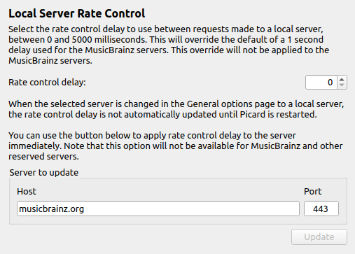
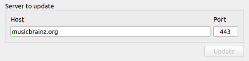

Local Server Rate Control
==========================

Overview
---------

This plugin allows the user to set the rate control delay to use for a local server. This will override the default of a 1 second delay used for the MusicBrainz servers. The delay between requests is set in milliseconds (between 0 and 5000) in an options page under the Plugins section. This override will not be applied to the MusicBrainz servers.

What it Does
-------------

When Picard is started with this plugin activated, it checks whether a custom local server has been configured. If the server configured is not a standard MusicBrainz server, then the plugin sets the rate control delay to the value set in the plugin's option settings page.

.. note::

   If you change the server host or port settings, or the rate control delay to use for local servers, the rate control changes will not be automatically applied until the next time Picard is started. To apply the rate control delay changes immediately without having to restart Picard, use the :guilabel:`Update` button on the Server Rate Control options page.

Option Settings
----------------

The plugin adds a settings page under the "Plugins" section under "Options..." from Picard's main menu. This allows you to set the minumum rate control delay to use for a local server.

|

Rate control delay
+++++++++++++++++++

This setting allows you to set the minumum rate control delay to use for a local server.

Server to update
+++++++++++++++++

This displays the currently configured server, which is the one that will be updated if the :guilabel:`Update` button is clicked. If you are changing the server settings in the General options page, you will need to save those changes before returning to this options page to update the server's minimum rate control delay.

If the configured server is one of the MusicBrainz servers or one of the other reserved servers, then the :guilabel:`Update` button will be disabled.

|

Examples
---------

There are no examples.

Source Code
------------

The source code for this plugin is available on `GitHub <https://github.com/rdswift/picard-plugin-local-server-rate-control>`_.
