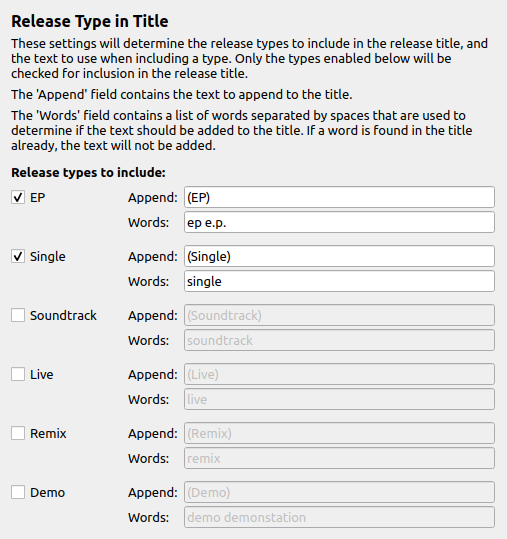

Release Type in Title
======================

Overview
---------

This plugin automatically places selected release type information in the title of the release.

The plugin is based on the Picard 2 plugin "Release Type" by Elliot Chance. The original Picard 2 plugin code is available on GitHub at "`Release Type <https://github.com/metabrainz/picard-plugins/blob/2.0/plugins/release_type/release_type.py>`_".

What it Does
----------------

The plugin checks the existing release title to determine whether the release type already appears in the title. If not, and the release type is one of those selected for inclusion, the release type text is appended to the release title.

The release types to include, the keywords to check, and the text to add are defined by the user in the plugin's option settings.

Option Settings
----------------

The settings panel allows the user to provide a list of the tags to keep.

|
| Each of the available release types that can be appended to the release title can be enabled individually. These include ep, single, soundtrack, live, remix and demo. For each type, you can set the text that will be appended to the title, as well as the list of keywords to check to determine whether the type needs to be appended.

If the append string already appears in the title, or if a word from the keywords list appears in the title, then the title will not be changed. Note that all comparisons are performed on a case-insensitive basis.

The type string will only be appended if the type is the primary album type, or one of the secondary album types for the release.

Examples
---------

With the default plugin setting, when the release `Wrecking Ball <https://musicbrainz.org/release/8c759d7a-2ade-4201-abc2-a2a7c1a6ad6c>`_ by Sarah Blackwood is loaded from MusicBrainz, the release title is automatically changed to "Wrecking Ball (Single)" because the primary release type is ``single``.

Source Code
----------------

The source code for this plugin is available on `GitHub <https://github.com/rdswift/picard-plugin-release-type-in-title>`_.
